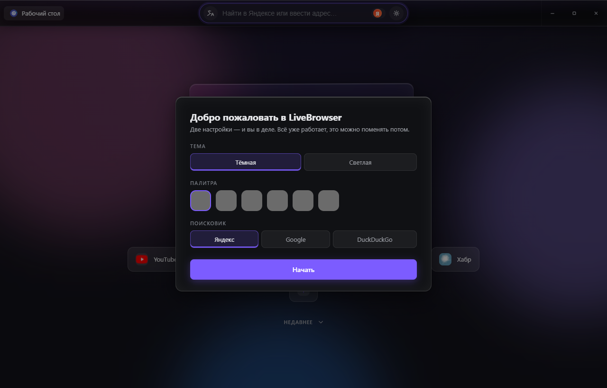

# LiveBrowser

**Браузер, в котором хочется остаться.** Тёмное стекло, живые часы, настоящая погода, пять палитр, командная палитра на `Ctrl+K` и адресная строка, которая понимает, что вам нужно — сайт или ответ.

Сделан на **WebView2 + .NET 8** (C#) с собственной оболочкой на чистом JS/CSS: без Electron, без фреймворков, без `node_modules`. Установщик — один `.exe`, не требует прав администратора.



## Установка

Скачайте **`LiveBrowser-Setup-1.0.0.exe`** со страницы [Releases](../../releases) и запустите.

- Ставится в профиль пользователя — `%LOCALAPPDATA%\Programs\LiveBrowser`. Права администратора не нужны.
- Ярлык в «Пуск» создаётся всегда, ярлык на рабочем столе — по галочке.
- Если в системе нет рантайма WebView2, установщик поставит его сам.
- Удаление — через «Параметры → Приложения», как у любой программы.

Windows 10/11 x64. Всё остальное уже внутри: .NET не нужен, скачивать ничего не придётся.

## Что умеет

**Рабочий стол вместо пустой страницы.** Часы, дата, погода по вашему городу (Open-Meteo, без ключей и регистраций), плитки любимых сайтов с настоящими иконками и блок недавно закрытых вкладок.

**Оболочка, а не рамка.** Матовое стекло, пружинные анимации, параллакс от мыши, акцентный цвет, который подстраивается под сайт. Три темы — тёмная, светлая и Night City с глитчем — и пять палитр.

**Вкладки как надо.** Пробуждение спящих вкладок (неактивные отпускают память), поиск по открытым, закрытие средней кнопкой, перетаскивание, восстановление сессии после перезапуска. Приватные окна со своей сессией, которая стирается при закрытии.

**Адресная строка с мозгами.** Ввод адреса открывает сайт, запрос уходит в поиск. Живые подсказки, история, закладки, `Ctrl+L` из любого окна.

**Командная палитра (`Ctrl+K`).** Всё сразу: вкладки, команды, настройки. Нечёткий поиск, подсветка совпадений, стрелки.

**Перевод на месте.** Выделили текст — перевели, не уходя со страницы. Направление языка меняется одним кликом.

**Тихая работа.** Блокировка рекламных и трекерных хостов из коробки, режим чтения, поиск по странице, масштаб с запоминанием по сайту, загрузки с историей.

## Горячие клавиши

| | |
|---|---|
| `Ctrl+T` / `Ctrl+W` | новая вкладка / закрыть |
| `Ctrl+Shift+T` | вернуть закрытую |
| `Ctrl+L` / `F6` | в адресную строку |
| `Ctrl+K` | командная палитра |
| `Ctrl+N` / `Ctrl+Shift+N` | новое окно / приватное окно |
| `Ctrl+F` / `Ctrl+P` | поиск по странице / печать |
| `Ctrl+R` / `F5` | обновить |
| `Ctrl+Tab` / `Ctrl+Shift+Tab` | следующая / предыдущая вкладка |
| `Ctrl+=` `Ctrl+-` `Ctrl+0` | масштаб / сброс |
| `Alt+←` `Alt+→` | назад / вперёд |
| `F11` | полноэкранный режим |

## Сборка из исходников

Нужен только Windows и Python 3 с Pillow — **и всё**: .NET SDK устанавливать не надо, он лежит в `build/dotnet-sdk`.

```bat
build.bat
```

Соберёт самодостаточную (self-contained) сборку в `dist\`. Затем установщик:

```bat
build\nsis\nsis-3.10\makensis.exe installer\livebrowser.nsi
```

Готовый setup появится в `installer\`. Иконка собирается из `build-logo\draw.py` (там же лежит источник знака и объяснение, почему он такой):

```bat
python -I build-logo\draw.py
```

### Как устроено

```
host\        C# хост: окно, вкладки, WebView2, IPC, античит, пробы
shell\       оболочка на чистом JS/CSS: рабочий стол, омнибокс, палитра, темы
build-logo\  генератор иконки (Python + Pillow) и logo\ с SVG-исходником
installer\   NSIS-скрипт установщика
test\        локальные страницы для тестов
```

Хост владеет окном и геометрией, оболочка — содержимым и вкладками; общаются JSON-сообщениями через WebView2. Так `Ctrl+L` работает одинаково и из оболочки, и с открытого сайта: таблица горячих клавиш живёт в одном месте (`host\Hotkeys.cs`), а не в трёх.

## Проверка

Внутри — собственный набор проб, который прогоняет живой браузер:

```bat
run-probe.bat
```

Проверяются вкладки, пробуждение, горячие клавиши, приватные окна, блокировка рекламы, ошибки сети (DNS, TLS, офлайн), анимации, память под нагрузкой и то, что настройки переживают перезапуск. Часть проб обращается к настоящему интернету (`example.com`, `ru.wikipedia.org`, `self-signed.badssl.com`), поэтому на машине без сети они честно помечаются как пропущенные, а не зелёные.

## Чего здесь нет

- **Не Chromium с нуля.** Это окно-приложение на WebView2 (движок Edge). Стекло видно на фоне оболочки, но не поверх открытого сайта: для этого движок пришлось бы пересобирать на C++.
- **Нет синхронизации** и нет аккаунта. Всё живёт на вашей машине — `profile\`, `settings.json`, `history.jsonl` рядом с программой.
- **Перевод** идёт через внешний сервис MyMemory; без интернета остальные функции работают.

## Лицензия

MIT — см. [LICENSE](LICENSE).
